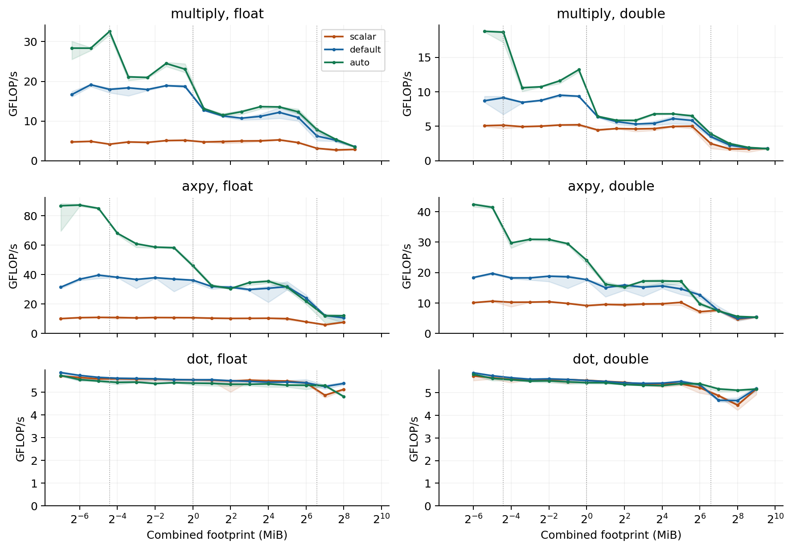
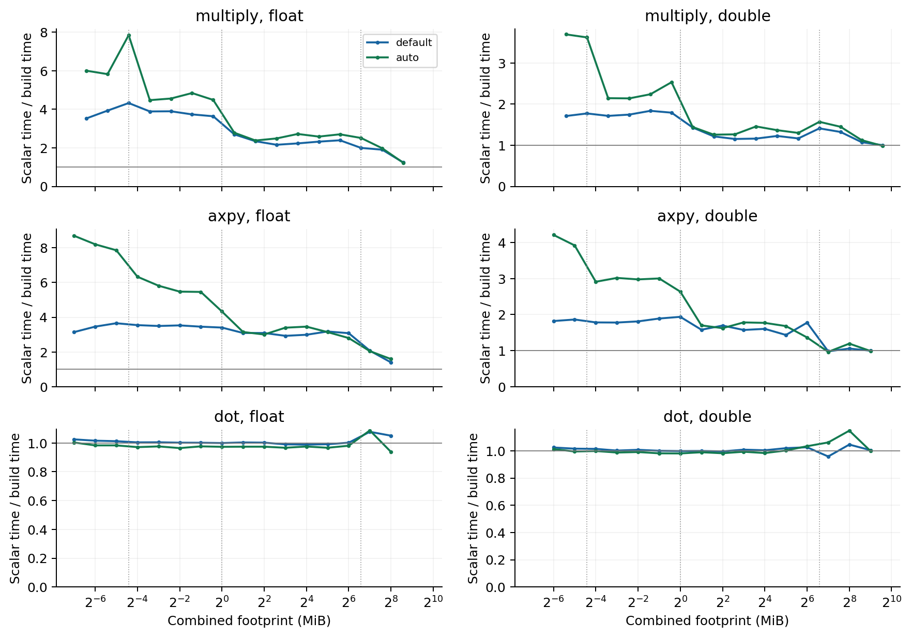
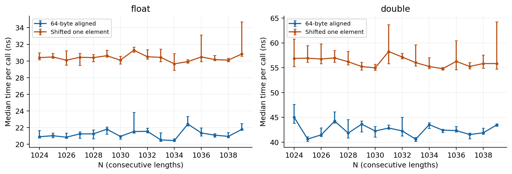
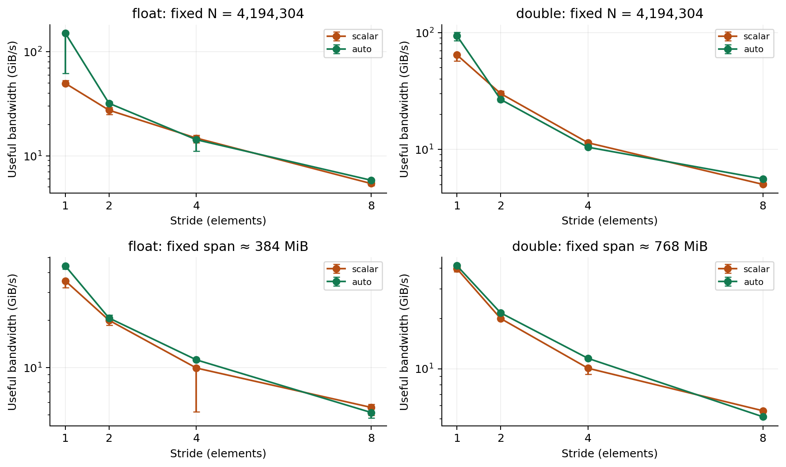
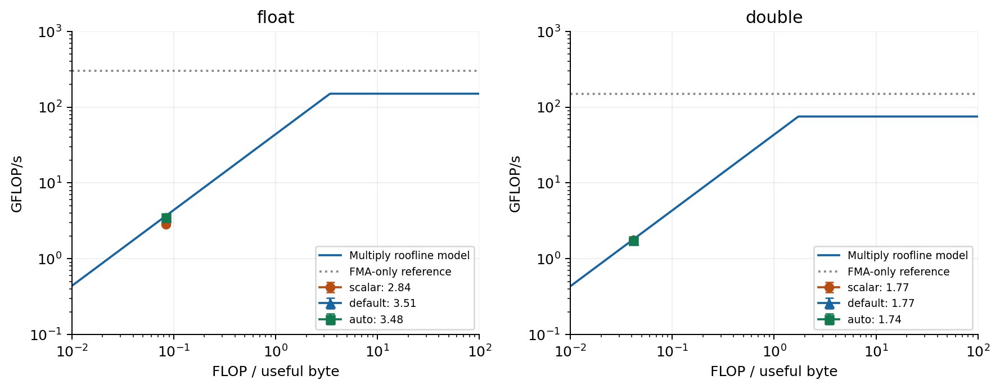
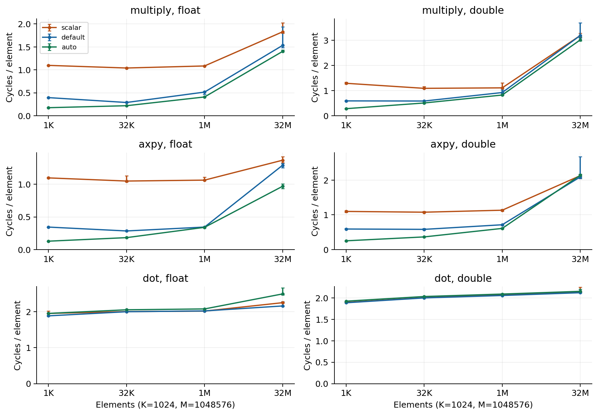

# SIMD Advantage Profiling

Andrew Zheng | Advanced Computer Systems | Project 1 | October 17, 2026

## Purpose

This project tests when SIMD makes a program faster. SIMD lets one instruction work on several numbers at once. The tests compare three versions of the same code: a scalar version, which uses scalar arithmetic, a version with the compiler's default vectorization, and a native version built for this CPU.

The main finding was that SIMD helped multiplication and AXPY most with small arrays. With large arrays, moving data became more important and the speedup was smaller. Dot product showed little improvement because adding the products together still involved a chain of dependent operations.

## Computer and setup

| Item | Setup |
| --- | --- |
| CPU | AMD Ryzen 7 9850X3D, 8 cores and 16 logical CPUs |
| Cache | 48 KiB L1 data cache per core, 1 MiB L2 per core, 96 MiB shared L3 |
| Available instructions | x86-64, SSE, AVX2, AVX-512, and FMA |
| OS | Ubuntu 24.04.5 LTS in WSL2 |
| Kernel | `6.18.33.2-microsoft-standard-WSL2` |
| Compiler | GCC 13.3.0 |
| Threads | One benchmark thread; final build comparison pinned to CPU 0 |
| Other settings | SMT enabled; Windows Balanced power plan in the recorded snapshot |
| Frequency | Linux frequency controls unavailable; operating frequency not recorded |

The system snapshot was collected after the experiments. It does not prove that every earlier run used the same settings. CPU pinning reduces movement between guest CPUs, but it does not reserve a physical core or stop Windows background activity. BIOS and power settings were not confirmed to be unchanged across all runs.

## What was tested

The tests used both `float` and `double`. A float takes 4 bytes and a double takes 8 bytes. The same vector can therefore hold twice as many floats as doubles.

| Kernel | Operation | Work per element | Useful bytes per element |
| --- | --- | ---: | ---: |
| Multiply | `z[i] = x[i] * y[i]` | 1 floating-point operation | 3T |
| AXPY | `y[i] += a * x[i]` | 2 floating-point operations | 3T |
| Dot product | `sum += x[i] * y[i]` | 2 floating-point operations | 2T |

Here, T is 4 bytes for float or 8 bytes for double. Useful bytes count the reads and writes needed by the calculation, not all traffic inside the hardware. Multiply stores three arrays, while AXPY and dot product each store two. The combined array size is the working set.

The final data contains 4,508 batch measurements: 2,016 for the three-build comparison, 1,008 for alignment and leftover elements, 896 for stride, 84 for bandwidth calibration, and 504 for hardware counters. Earlier two-build results were not used as the final baseline.

## Build and timing method

All three kernel builds used `-O3`. The main differences were:

| Build | Main setting |
| --- | --- |
| Scalar | `-march=native -fno-tree-loop-vectorize -fno-tree-slp-vectorize` |
| Default | Compiler vectorization enabled without a CPU-specific target |
| Native | Compiler vectorization enabled with `-march=native` |

All builds also used `-ffp-contract=off`, which prevented the compiler from combining multiply and add into an FMA instruction. The timing code was built separately with `-O2`, and the correctness checker used `-O0`. Link-time optimization was not used.

Each timed batch repeated the kernel until it lasted about 30 ms, or reached the repetition limit. Seven trials were kept, with two warmup calls before each trial. Allocation, initialization, correctness checks, and writing CSV files were outside the timed batch. The final comparison tested array lengths from 2^10 through 2^25 and rotated the order of the builds and kernels.

The tables use medians. Plot ranges show the minimum and maximum results, not confidence intervals. Speedup is calculated as scalar median time divided by vector-build median time. A speedup of 2 means twice as fast; a value below 1 means slower.

Correctness checks covered lengths 0, 1, 5, 8, 16, 17, 27, 32, 33, and 1000 for both types. Inputs were chosen so repeated calculations could be checked reliably. AXPY alternated positive and negative coefficients to return the output to its starting value. Dot product used a repeating input pattern to keep the sum from growing too large.

## Checking that SIMD was used

The compiler reports showed 16-byte vectors for the default build. The inspected native multiply and AXPY code used 64-byte vectors. A compiler report alone does not show whether the full calculation becomes faster, so the generated assembly was also inspected.

The following are shortened examples from the native float code:

```asm
multiply: vmovups zmm1, [x]    vmulps zmm0, zmm1, [y]
vmovups [z], zmm0
dot:      vmulps zmm1, zmm5, [y]
vaddss xmm0, xmm0, xmm1 ... repeated into xmm0
```

For multiply, `vmulps` multiplies several floats at once. The dot product also multiplies several values at once, but `vaddss` adds one float at a time into the running sum. Each addition depends on the previous sum. That remaining dependency helps explain why dot product did not gain much speed.

The scalar code can still use XMM registers. Their presence alone does not mean several numbers are being processed together. No FMA was found in the inspected AXPY loop, matching the compiler setting.

## 1. Throughput and array size



*Figure 1. Median throughput for the three kernels and builds. Shading shows minimum–maximum results. The vertical lines mark the reported cache sizes.*

Throughput measures how much work is completed per second. Here it is shown in GFLOP/s, or billions of floating-point operations per second.

Multiply and AXPY benefited from SIMD with small arrays. These calculations have many independent elements that can be processed together. As arrays became larger, throughput generally fell and the builds became closer in performance. Waiting for data became more important than the number of values handled by one instruction.

At the largest tested length, native float multiply reached 3.479 GFLOP/s and double multiply reached 1.743 GFLOP/s. Native AXPY reached 11.967 GFLOP/s for float and 5.309 GFLOP/s for double. The kernels do different amounts of calculation per byte, so their GFLOP/s values do not directly measure equal memory use.

Dot product stayed close to scalar performance. Its running sum limited how much work could happen at once. The test did not enable fast-math settings that would allow the compiler to rearrange the additions.

## 2. SIMD speedup



*Figure 2. Scalar time divided by default or native time. The horizontal line at 1 means equal performance.*

| Native kernel | Speedup at N = 1,024 | Speedup at N = 33,554,432 |
| --- | ---: | ---: |
| Float multiply | 6.00× | 1.23× |
| Float AXPY | 8.69× | 1.59× |
| Double multiply | 3.70× | 0.98× |
| Double AXPY | 4.21× | 0.99× |

SIMD gave large improvements for small arrays, but much smaller improvements for large arrays. Double multiply and AXPY were about the same speed as scalar at the largest size.

At equal array length, doubles need twice as much memory as floats, and fewer doubles fit in one vector. Both differences affect performance. Wider vectors also did not always beat the default build. With large arrays, memory traffic and timing variation can matter more than vector width.

## 3. Alignment and leftover elements



*Figure 3. Native multiply with aligned and shifted arrays. Points show medians and bars show minimum–maximum results.*

Alignment describes where an array starts in memory. This test compared arrays starting on a 64-byte boundary with arrays shifted by one element: 4 bytes for float or 8 bytes for double. All three arrays received the same shift.

Lengths from 1,024 to 1,039 tested cases where the number of elements did not always divide evenly into a vector. Larger lengths of 65,536 and 65,537 were also tested.

| Case | Aligned time | Shifted time | Shifted / aligned |
| --- | ---: | ---: | ---: |
| Float, N = 1,024 | 20.89 ns | 30.40 ns | 1.455 |
| Double, N = 1,024 | 44.98 ns | 56.87 ns | 1.264 |
| Float, N = 65,536 | 3.155 µs | 3.147 µs | 0.997 |
| Double, N = 65,536 | 10.842 µs | 11.409 µs | 1.052 |

The shifted arrays were slower in the small cases. Accesses crossing cache-line boundaries may contribute, but the test did not isolate that cause. The difference was smaller for the larger cases.

The inspected code could handle unaligned addresses. It processed full 64-byte vectors, then an optional 32-byte block, then any remaining elements individually. The remaining elements are often called the tail.

Adding one element did not always increase the measured time. Aligned float multiply at 65,537 elements was faster than at 65,536 in these results. This shows why small timing changes should not all be blamed on tail handling. The checks detected incorrect output and out-of-range writes, but did not prove that no out-of-range reads occurred.

## 4. Stride and bandwidth



*Figure 4. Results for strides 1, 2, 4, and 8. The top keeps the number of operations fixed; the bottom keeps the total address span approximately fixed. Bars show minimum–maximum results.*

Stride is the distance between elements accessed. Stride 1 uses consecutive elements, while stride 2 uses every second element. One set of tests kept the number of operations the same while the address span grew. Another kept the span about the same while reducing the number of operations.

In the largest fixed-span native cases, useful bandwidth fell from 44.28 to 5.18 GiB/s for float and from 41.46 to 5.15 GiB/s for double between strides 1 and 8. Larger strides use fewer elements from each fetched cache line, which can waste data movement.

There was also a code difference: only stride 1 used the vector loop. The other tested strides used scalar multiplication. The slowdown therefore combines a change in memory access with a loss of SIMD. It cannot be explained by cache-line use alone.

## 5. Bandwidth and the roofline model



*Figure 5. Largest-size multiply results compared with a simple performance model. The model uses measured useful bandwidth and an assumed 4.7 GHz clock for the compute estimate.*

The roofline model compares two possible limits: how fast the CPU can calculate and how fast data can be supplied. Its basic form is:

`performance = min(compute limit, bandwidth × operations per byte)`

Multiply performs one operation for every 12 useful bytes for float, or every 24 useful bytes for double. A separate streaming-add test provided a bandwidth reference using two reads and one write. Its largest arrays exceeded the cache size.

| Quantity | Float | Double |
| --- | ---: | ---: |
| Useful bandwidth reference | 40.93 GiB/s | 40.56 GiB/s |
| Operations per byte | 1/12 | 1/24 |
| Performance from bandwidth reference | 3.662 GFLOP/s | 1.815 GFLOP/s |
| Measured native multiply | 3.479 GFLOP/s | 1.743 GFLOP/s |
| Measured / reference | 95.0% | 96.1% |

GiB/s was converted to decimal bytes per second before calculating the reference. The measured results were close to it, which supports the explanation that large-array multiply was mainly limited by data movement.

The compute estimate assumes two 512-bit multiplies per cycle at 4.7 GHz. That gives 150.4 GFLOP/s for float and 75.2 GFLOP/s for double, well above the large-array results. The clock is an assumption based on the listed base frequency [1], and the instruction rate comes from the Zen 5 research in [2]. It is not a measurement of the clock during testing.

The bandwidth reference counts useful bytes, not physical DRAM traffic. It is a comparison point rather than a strict hardware limit. Small arrays served by cache can exceed this memory-bandwidth reference.

## 6. Hardware cycles per element



*Figure 6. User-mode CPU cycles per element. Points show medians of seven trials and bars show minimum–maximum results.*

Hardware counters provided another way to compare the builds. Cycles per element were calculated as:

`cycles per element = counted cycles / (kernel calls × array length)`

The counter was enabled around the kernel batch and disabled before checking results. Initialization and warmup were excluded. The counts include some timing and function-call overhead, but exclude kernel and hypervisor execution.

All 504 measurements reported equal enabled and running times, so no scaling for time-sharing the counter was needed. These are counters exposed through WSL, not measurements from an isolated bare-metal system.

For 1,024 elements, float multiply used 1.097 cycles per element in scalar form and 0.175 in native form. Double multiply used 1.290 and 0.281. At the largest size, double AXPY was nearly unchanged: 2.126 scalar and 2.139 native cycles per element.

This agrees with the main pattern: SIMD helped more for small arrays. The counter and timing tests were separate runs, so small differences between them should not be treated as exact matches or used to infer a precise CPU frequency.

## Limitations and conclusion

Some early informal runs had other applications open. Those runs were not used as a controlled background-load experiment or as the final baseline. Background activity and frequency were not continuously logged, and WSL still depends on host scheduling. Some cases also had large timing ranges.

Cache boundaries in the plots are approximate. No cache-miss or physical-memory-traffic counters were collected for this project, so explanations about those effects are interpretations of the timing results.

The main conclusion is that SIMD does not guarantee a large speedup. It worked well for small, contiguous multiply and AXPY arrays. With large arrays, memory traffic reduced the benefit. Double multiply at the largest size is a clear example: the native build used SIMD but had only 0.98× scalar speed. Dot product also showed that vector multiplication alone does not remove a dependent sum. Non-unit strides lost the vectorized code path entirely.

## Reproducibility

The supporting material includes benchmark source, build and run scripts, raw measurements, summary tables, plotting scripts, compiler reports, and assembly dumps. These files provide the details behind the figures and allow the results to be checked. The figures use the selected final datasets described above; the early two-build sweep is separate.

## Use of Artificial Intelligence (AI)

I used ChatGPT to help explain SIMD concepts, work through benchmark changes, and interpret results. It was also helpful when I was stuck or confused. I left out material that I did not understand and focused on results I could follow. AI also helped with the explanations in this report to better convey my explainations.

## References

[1] AMD, [Ryzen 7 9850X3D specifications](https://shop-us-en.amd.com/amd-ryzen-7-9850x3d-processor/).

[2] Alexander Yee, [Zen5's AVX512 Teardown](https://www.numberworld.org/blogs/2024_8_7_zen5_avx512_teardown/).

[3] Linux man-pages, [perf_event_open](https://man7.org/linux/man-pages/man2/perf_event_open.2.html).
