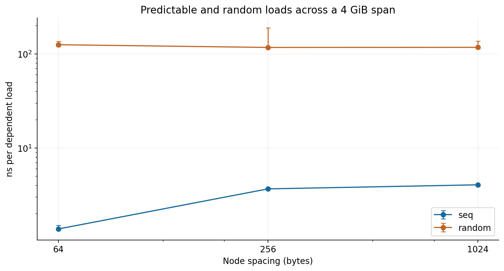
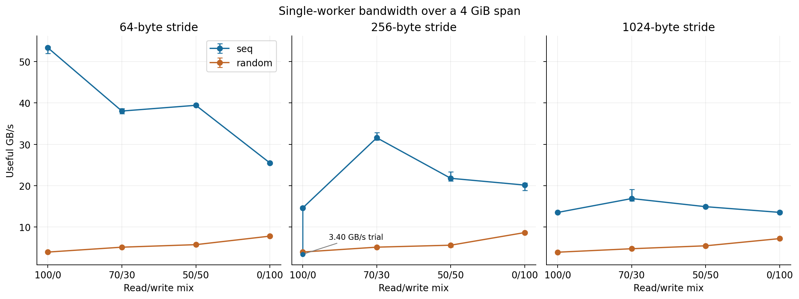
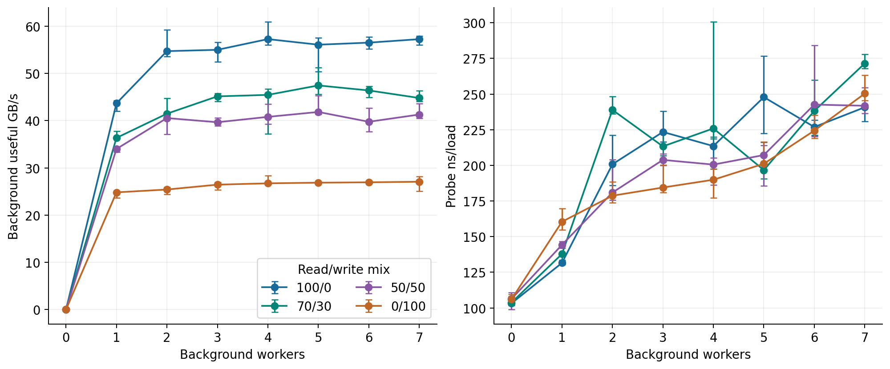
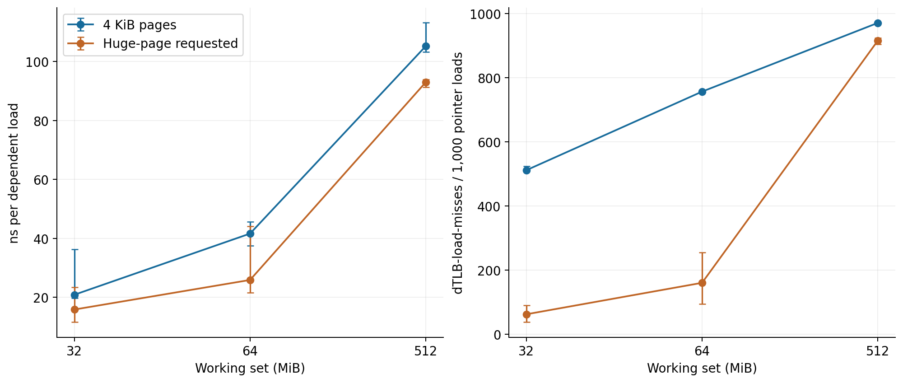
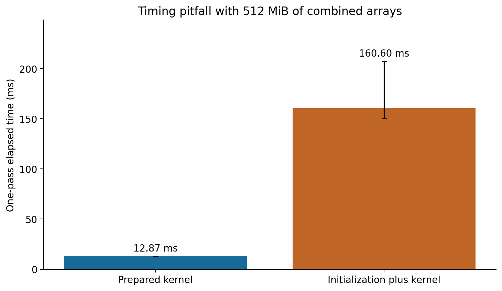

# Cache and Memory Performance Profiling

Andrew Zheng | Advanced Computer Systems | Project 2 | October 22, 2026

Measurements collected October 19–21, 2026, local New York time. Result-folder timestamps use UTC.

## Purpose and principal findings

This project measures how working-set size, access order, address spacing, read/write mix, concurrency, and page size affect memory performance on an AMD Ryzen 7 9850X3D running Ubuntu under WSL2. Custom C++ benchmarks provide the latency and bandwidth sweeps, while Linux performance counters record cache and translation events.

The measurements show three main behaviors. Small random pointer chains have sub-nanosecond effective load times, while a 512 MiB chain takes approximately 104 ns per load. Predictable sequential accesses are much faster than random accesses across a large allocation. Increasing the number of background workers eventually adds little useful bandwidth while increasing the latency seen by a dependent read probe. Huge pages reduce the reported TLB-miss count most strongly at intermediate working-set sizes.

A separate AXPY kernel demonstrates the practical effect of memory capacity and a measurement pitfall: including initialization increases the median one-pass time for 512 MiB of arrays from 12.87 ms to 160.60 ms. Generic cache-miss counts do not consistently explain AXPY runtime; that limitation is part of the result.

**Reading guide:** [Configuration](#system-configuration), [methods](#measurement-methods), [baseline latency](#baseline-latency-and-working-set-transitions), [patterns](#access-pattern-and-spacing), [bandwidth](#read-and-write-bandwidth), [loaded latency](#throughput-and-loaded-latency), [pages and TLBs](#page-size-and-tlb-behavior), [AXPY](#computation-and-cache-counters), [pitfall](#benchmark-pitfall), [models](#amat-and-littles-law), [reproduction](#reproducing-the-work), and [data](#data-and-provenance).

## System configuration

| Property | Recorded configuration |
|---|---|
| Processor | AMD Ryzen 7 9850X3D; 8 cores and 16 logical CPUs |
| Data-cache capacities | L1d: 48 KiB per core; L2: 1 MiB per core; shared L3: 96 MiB |
| OS | Ubuntu 24.04.5 LTS under WSL2 |
| Kernel | `6.18.33.2-microsoft-standard-WSL2` |
| Compiler | GCC/G++ 13.3.0 |
| Guest memory | Approximately 15 GiB RAM and 4 GiB swap |
| Physical memory | User-reported 32 GB; effective DRAM speed was not recorded |
| SMT | Enabled; guest CPU pairs 0/1, 2/3, …, 14/15 share reported cores |
| NUMA | One guest-visible node containing CPUs 0–15 |
| Frequency policy | No readable scaling driver/governor files at the checked guest paths; host policy was not recorded |
| BIOS settings | CPU and memory settings unchanged throughout the experiments, as confirmed by the operator |
| Base and huge pages | 4 KiB base pages; 2 MiB huge pages; THP policy and defrag policy set to `madvise` |
| Counter access | `perf_event_paranoid=2`; direct `perf` binary version 6.8.12 worked |

Later single-worker runners explicitly use guest CPU 0. Loaded-latency benchmarks place the probe on CPU 0 and background workers on CPUs 2, 4, 6, 8, 10, 12, and 14, avoiding sibling pairs in the reported guest topology. Guest affinity does not guarantee physical host-core placement. The early standalone sweep CSV does not itself record affinity, so its pinning cannot be independently verified from that file.

The counter-based kernels call `perf_event_open` directly. The `/usr/bin/perf` wrapper initially requested tools matching the WSL kernel; `/usr/lib/linux-tools/6.8.0-147-generic/perf` was usable for preliminary checks. No claim is made that the guest and host share identical counter or frequency behavior.

See the original [system output](results/system_info.txt), [topology](results/cpu_topology.txt), [page configuration](results/hugepage_info.txt), [final configuration](results/config_final.txt), and [configuration notes](report/data/configuration_notes.txt).

## Measurement methods

All headline values are medians. Error bars show the observed minimum and maximum, not confidence intervals. Most cases have five trials within a process; the counter experiment has two fresh-process repetitions with five trials each. These repetitions characterize observed variation but are not a large independent statistical sample. Slow trials remain in the raw data.

| Experiment | Timed work and controls | Measurements |
|---|---|---|
| Random latency sweep | One dependent pointer chain; 64-byte nodes; 8 million loads per trial; setup and full-chain warmup excluded | 31 sizes × 5 trials = 155 rows |
| Pattern latency | Sequential or shuffled chain, 64/256/1024-byte node spacing, 4 GiB allocation; 8 million dependent loads | 6 cases × 5 = 30 rows |
| Bandwidth | Sequential or shuffled 64-byte blocks at three strides; all eight words accessed; four read/write mixes | 24 cases × 5 = 120 rows |
| Read-only loaded latency | Random 512 MiB probe plus 0–7 private streaming workers | 8 cases × 5 = 40 rows |
| Mixed loaded latency | Four background mixes, 0–7 workers, 512 MiB per thread, two-second measurement windows | 32 cases × 5 = 160 rows |
| Page counters | Small/huge mappings at 32/64/512 MiB; cache and TLB event groups in separate runs | 120 rows; 10 per size/page/event combination |
| AXPY | `y[i] = 0.5*x[i] + y[i]`; 15 combined array sizes plus two setup comparisons | 17 cases × 5 = 85 rows |

Pointer chains make each load address depend on the preceding load. Their time per load is an effective serialized access time, including loop, translation, clock, and scheduling effects. It approximates an unloaded baseline at the application level; it does not prove that the physical memory system has no other requests.

Bandwidth kernels count useful software bytes. They do not count all write allocation, eviction, prefetch, page-walk, or bus traffic. AXPY counts 24 useful bytes per element update: read `x`, read `y`, and write `y`. Its vectorized, overlapping updates mean that time per element is not individual memory-load latency.

Counter groups are enabled around the measured region, excluding allocation and initialization except in the intentional setup-inclusive test. They exclude kernel and hypervisor execution. The page-counter and AXPY datasets report running fractions of 1.0 throughout. This establishes that no multiplexing scaling was needed, not that each event has a verified architectural meaning. Linux documents the platform dependence of generic cache events [1].

## Baseline latency and working set transitions


*Figure 1. Random dependent-load time versus allocation size. Dotted lines mark the cache capacities reported by the guest. Five trials per point; median and min–max range.*

| Representative region | Working set | Median ns/load | Observed range |
|---|---:|---:|---:|
| L1d-resident | 16 KiB | 0.717 | 0.715–0.799 |
| L2-resident | 512 KiB | 3.290 | 3.212–3.299 |
| L3-resident | 8 MiB | 10.636 | 10.541–11.020 |
| DRAM-dominated | 512 MiB | 103.839 | 102.351–104.856 |

These are representative working-set measurements, not isolated component specifications. At 48 KiB, the median is 0.744 ns; at 56 KiB it is 2.522 ns, giving a clear change near the reported L1d capacity. The transition around the 1 MiB L2 boundary is less abrupt. The 4–8 MiB region is near 10–11 ns, while 32 MiB reaches 17.681 ns. The 64 MiB result is variable (29.443–55.538 ns), and 96 MiB reaches a 64.752 ns median. Performance changes before or around the nominal L3 capacity because usable residency and translation behavior are not determined by nominal capacity alone.

The initial four-size baseline and the later dense sweep are separate runs; the table above consistently uses the dense sweep. The full sweep is retained rather than selecting the lowest trial. Results remain in nanoseconds because a measured, stable core frequency was not available. A conversion such as `cycles = ns × GHz` would require an explicitly measured frequency; nominal frequency or BogoMIPS is not substituted.

## Access pattern and spacing



*Figure 2. Effective dependent-load times for sequential and random traversal. Both axes are logarithmic. Node spacing describes the address grid; a random jump can span many grid positions.*

| Node spacing | Sequential median ns/load | Random median ns/load | Random / sequential |
|---|---:|---:|---:|
| 64 B | 1.379 | 125.774 | 91.2× |
| 256 B | 3.682 | 117.636 | 32.0× |
| 1024 B | 4.066 | 117.897 | 29.0× |

Each operation reads one 8-byte pointer. Larger spacing increases sequential effective time, while random medians remain roughly 118–126 ns. Predictable addresses are consistent with prefetching and spatial locality reducing effective access time. The small sequential values are therefore not interpreted as isolated DRAM device latency.

The allocation span is fixed at 4 GiB, but the full-cycle cache-line footprints are 4 GiB, 1 GiB, and 256 MiB as spacing increases. All exceed the reported 96 MiB L3, although spacing also changes footprint and page locality. Eight million loads can cover part of a large cycle or wrap a smaller one. Setup and full-cycle warmup are excluded. No major faults or guest swap activity occurred. Two minor faults were recorded in the first trial of each case and zero thereafter; aggregate fault counts do not identify their source.

One random-256 trial reached 189.946 ns. It is included in the range; its cause was not established.

## Read and write bandwidth



*Figure 3. Useful throughput for one worker across a 4 GiB allocation. Lines connect categorical mix settings for comparison; error bars show all five trials.*

| Pattern | Stride | 100% read | 70/30 | 50/50 | 100% write |
|---|---:|---:|---:|---:|---:|
| seq | 64 B | 53.35 | 38.04 | 39.43 | 25.50 |
| seq | 256 B | 14.62 | 31.57 | 21.77 | 20.14 |
| seq | 1024 B | 13.52 | 16.87 | 14.91 | 13.53 |
| random | 64 B | 3.93 | 5.11 | 5.73 | 7.79 |
| random | 256 B | 3.94 | 5.12 | 5.60 | 8.65 |
| random | 1024 B | 3.90 | 4.74 | 5.45 | 7.19 |

*Table values are useful GB/s, using decimal gigabytes.*

Sequential 64-byte reads reach 53.35 GB/s versus 3.93 GB/s for random reads. At 256- and 1024-byte strides, selected cache lines are farther apart and sequential read throughput drops substantially. Random read throughput stays near 3.9 GB/s. Random writes have higher useful throughput than random reads in this kernel, but this does not establish lower write latency: buffering, ownership traffic, and overlapping stores differ from dependent reads.

The byte mix is implemented using disjoint read and write lines in groups of ten. Random access also reads a precomputed index array; index traffic contributes to time but is excluded from useful bytes. Stores are checked outside timing. A final fence does not flush all dirty data to DRAM.

The original sequential-256/read-only case contained one 3.40 GB/s trial. A separate five-trial check supplied by the operator had a 14.51 GB/s median, close to the original 14.62 GB/s median. The original observation remains in Figure 3; no cause is assigned. The rerun is retained in [the original repeat CSV](results/bandwidth_seq256_read_repeat.csv), rather than pooled with the original case.

## Throughput and loaded latency


*Figure 4. Direct throughput–latency comparison. Faint dots are paired trial results. Selected numbered points are case medians, connected in increasing worker count, not sorted by throughput. Coordinate medians need not correspond to one observed trial.*



*Figure 5. The same mixed-intensity measurements against worker count, with min–max ranges. All latency values are read-probe latency, including the write-only background case.*

| Background read/write mix | Highest case-median GB/s | Workers at that maximum | Idle median ns/load | Seven-worker median ns/load |
|---|---:|---:|---:|---:|
| 100/0 | 57.284 | 4 | 103.270 | 240.724 |
| 70/30 | 47.470 | 5 | 103.794 | 271.472 |
| 50/50 | 41.849 | 5 | 106.328 | 241.774 |
| 0/100 | 27.069 | 7 | 106.060 | 250.326 |

The saturation region is more useful than the single maximum. Read-only throughput reaches 54.735 GB/s at two workers and stays around 55–57 GB/s afterward. From two to seven workers it grows only about 4.6%, while read-probe latency rises from 200.778 to 240.724 ns. The 50/50 case also largely levels off near two workers, at approximately 40–42 GB/s. Write-only traffic already reaches 24.817 GB/s with one worker and gains only about 9.1% by seven workers, while probe latency rises from 160.469 to 250.326 ns.

The 70/30 case is less regular. Its throughput grows from 41.485 GB/s at two workers to 47.470 GB/s at five before declining, while latency is non-monotonic. The data support a broad saturation region, not one precisely located knee for every mix. Variation can include scheduling, cache and translation effects as well as memory-system contention.

The probe and each worker have private 512 MiB mappings. Workers use exact read/write proportions in 64,000-byte chunks; the probe follows a random chain. A common two-second window follows a 250 ms lead-in. Only complete chunks within the window contribute. Worker read checksums and written values are validated after timing. Background throughput excludes probe bytes, and wall-clock probe latency can include preemption.

An earlier read-only implementation independently showed saturation near two workers (58.963 GB/s and 181.290 ns at two; 57.229 GB/s and 215.004 ns at seven). It used a different chunk size and fence policy. Its results are retained as a separate experiment; comparisons among the four mixes use the revised implementation consistently.

## Page size and TLB behavior



*Figure 6. Latency and reported dTLB-load-misses from the same TLB-counter runs. Each point combines two fresh processes with five trials each. Counts are normalized per 1,000 pointer loads, not presented as a miss probability.*

| Working set | Small-page latency ns | Huge-page latency ns | Small-page misses/1,000 loads | Huge-page misses/1,000 loads |
|---|---:|---:|---:|---:|
| 32 MiB | 20.897 | 15.878 | 511.44 | 61.86 |
| 64 MiB | 41.631 | 25.910 | 756.55 | 159.98 |
| 512 MiB | 105.201 | 92.960 | 970.82 | 915.26 |

At 32 and 64 MiB, the huge-page configuration reduces the reported miss count by approximately 87.9% and 78.9%, with latency reductions of 24.0% and 37.8%. At 512 MiB, the corresponding reductions are about 5.7% and 11.6%. Larger translation coverage is consistent with the intermediate-size benefit, while translation pressure remains substantial at the largest working set.

The guest used `MADV_NOHUGEPAGE` or `MADV_HUGEPAGE`. Recorded `AnonHugePages` values were zero for small mappings and equal to the allocation size for huge mappings before and after the measured trials. This verifies guest anonymous huge-page backing in these runs; it does not establish host page size. THP and the reserved hugetlb pool are different mechanisms, so a zero reserved huge-page count does not imply that THP is unavailable [2].

Initial page-size tests included an unexpectedly slow huge-page result around 32 MiB. Both the original files and fresh-process repeats are retained. The counter experiment then repeated both modes, reversing their order in the second repetition. Order, allocation and timing effects are not separated enough to assign a cause to the initial anomaly. The table above consistently uses the controlled counter-run dataset.

## Computation and cache counters

The application kernel computes `y[i] = 0.5*x[i] + y[i]` on two arrays of doubles. The size is their **combined** capacity. Setup and one warmup pass are excluded from steady-state timing. Repeated passes process approximately 2 GiB of combined capacity per trial, and every output element is checked afterward. Compilation permits vectorization with `-O3 -march=native`.


*Figure 7. Steady-state useful throughput and the relationship between time per update and normalized generic cache misses. The correlation uses the 15 size medians, giving each size equal weight.*

| Combined array size | Median useful GB/s | Median ns/update |
|---|---:|---:|
| 48 KiB | 695.93 | 0.0345 |
| 64 KiB | 426.42 | 0.0563 |
| 1 MiB | 319.75 | 0.0751 |
| 2 MiB | 226.38 | 0.1060 |
| 64 MiB | 184.40 | 0.1302 |
| 96 MiB | 122.40 | 0.1961 |
| 128 MiB | 94.73 | 0.2533 |
| 512 MiB | 64.91 | 0.3697 |

The capacity-dependent throughput decline is clear, including changes near L1d and L2 and a broader decline toward DRAM-sized arrays. The very high small-array useful throughput reflects cache-served vectorized updates; it is not a DRAM bandwidth measurement.

The generic counter result is less straightforward. Misses per 1,000 updates are about 18.57 at 2 MiB but only 3.15 at 512 MiB, despite the longer time per update. Pearson correlation between normalized misses and normalized time across the 15 size medians is **r = 0.124**, a weak positive association. This descriptive calculation does not establish statistical significance or causation.

The generic event mapping was not verified against this processor's architectural events under WSL. Prefetching and overlapping accesses also separate visible stalls from aggregate event counts. Therefore the report does not label these events as measured L1/L2/L3 miss probabilities or claim that a rising generic miss rate explains the entire runtime trend. A future extension would validate model-specific event mappings and collect additional event groups; the present experiment reports the observed limitation.

## Benchmark pitfall



*Figure 8. One AXPY pass over 512 MiB of combined arrays, measured with initialization excluded or included. Both modes start from fresh mappings and produce the same final array values.*

| Timing region | Median elapsed time | Median minor faults |
|---|---:|---:|
| Prepared arrays; kernel only | 12.866 ms | 0 |
| Initialization plus kernel | 160.598 ms | 131,072 |

Including initialization makes the measured time **12.48× longer**. The 131,072 minor faults are consistent with first writes to 512 MiB in 4 KiB pages. The difference includes initialization instructions, fault servicing, and changed cache state; it is not solely the cost of page faults. `mmap` itself is outside both timing regions.

The correction is to define the intended measurement boundary, prepare and touch arrays before a steady-state test, and measure setup separately when end-to-end startup cost matters. The setup-inclusive result is valid for that broader question, but it would misrepresent steady-state kernel performance if labeled as kernel-only time. Counter exclusion of kernel execution also means fault-handling time and user-mode event counts do not describe identical work.

## AMAT and Little's Law

### AMAT reasoning

For a serial hierarchy, an incremental-penalty model is:

$$AMAT = t_1 + m_1\left(t_2 + m_2\left(t_3 + m_3t_M\right)\right)$$

Here the miss probabilities are conditional on reaching each level, and each time is the incremental cost at that level. The measured pointer-chain times are end-to-end working-set costs and include translation and loop effects, so they cannot simply be inserted as independent incremental penalties. Per-level miss probabilities were not measured reliably enough to reconstruct a measured AMAT.

A separate **illustrative sensitivity calculation** uses mutually exclusive service-location fractions and representative measured end-to-end times:

$$T_{example}=p_1L_1+p_2L_2+p_3L_3+p_ML_M,\qquad \sum p_i=1$$

Using `L = (0.717, 3.290, 10.636, 103.839) ns` and **assumed**, not measured, fractions `(0.90, 0.08, 0.015, 0.005)` gives **1.587 ns**. Increasing the assumed DRAM fraction to 2%, with fractions `(0.90, 0.07, 0.01, 0.02)`, gives **3.059 ns**. The example shows why a small slow-memory fraction can dominate the average. It is not an estimate of the actual AXPY miss distribution or a prediction of its vectorized time per element.

### Concurrency and Little's Law

Little's Law relates a system's average occupancy, completion/arrival rate and residence time [3]:

$$N=\lambda W$$

The quantities must describe the same request population and system boundary. A serial dependent chain supplies roughly one application-level demand load at a time. At 103.839 ns/load, its completion rate is approximately **9.63 million loads/s**; multiplying that rate by the same average time gives approximately one. This is a consistency check of serialization, not an independent measurement of physical memory queue occupancy.

For a scale illustration, **assume** useful bandwidth corresponds to 64-byte requests and that the independent probe's latency represents those requests. The mixed benchmark's two-worker read-only point gives:

$$N_{proxy}=\frac{54.735\times10^9}{64}\times200.778\times10^{-9}\approx171.7$$

This is a **conditional proxy, not measured queue depth**. Background streaming requests and random probe loads are different populations; prefetch, writeback, and page walks are omitted from useful throughput. Worker count is also not the number of outstanding memory requests. The defensible empirical conclusion is that, once throughput is near its plateau, additional concurrency yields little throughput gain while the probe often experiences longer delays. The precise contribution of physical DRAM queues is not isolated.

## Experimental limitations

- WSL2 exposes a virtualized execution environment. Host scheduling, background activity, physical NUMA placement, power policy, and actual frequency were not fully controlled or measured.
- BIOS settings were unchanged, but their exact values and effective DRAM speed were not captured. Nanoseconds are reported without an assumed cycle conversion.
- Cache-capacity markers are architectural reference points. Working-set measurements also include translation and replacement behavior, and the streaming kernel can overlap accesses.
- Generic cache and TLB events are retained under their requested Linux names. A successful counter read and a 1.0 running fraction do not establish a verified model-specific meaning.
- Five trials share a process and allocation for many cases. Case order was shuffled in later runners, but trial-level temporal drift remains possible. No statistical confidence claim is attached to min–max bars.
- Loaded latency is the latency of a read probe under four background mixes. Intrinsic write-completion latency is not separately measured.
- All original observations are retained. The broad saturation trends, huge-page effects, and setup pitfall are supported; anomalies are not given unsupported causes.

## Conclusions

The experiments connect three different performance questions. A dependent chain exposes the cost of waiting for each access, predictable streaming exposes the benefit of locality and overlap, and loaded-latency tests show the tradeoff between aggregate throughput and the delay seen by another requester. These metrics should not be substituted for one another.

The working-set sweeps show transitions consistent with the reported cache hierarchy. Larger pages reduce reported translation misses and effective latency most clearly at 32–64 MiB. Bandwidth approaches a plateau with relatively few workers, while additional load increases read latency. Finally, the AXPY setup comparison demonstrates that measurement boundaries can change reported runtime by more than an order of magnitude. The generic cache-counter limitation prevents a fully measured per-level AMAT reconstruction, but does not erase the directly observed timing and throughput results.

## Reproducing the work

### Regenerate the report figures

The figure builder uses the report's archived measurement snapshots, so it does not rerun benchmarks or overwrite original result folders. From the repository root:

```bash
python3 -m venv .venv-report
source .venv-report/bin/activate
python3 -m pip install -r project2-memory/report/requirements.txt
python3 project2-memory/report/make_figures.py
```

This generates eight PNG figures, the median/min/max tables in `report/processed`, and a SHA-256 manifest of the archived inputs. The README is the report text. Figure/table interpretation is written explicitly rather than generated from a fitted model.

### Build the benchmarks

Use an x86-64 Linux environment with G++, Python 3 and `taskset`. The code uses Linux mappings and counter APIs. From the repository root:

```bash
cd project2-memory
mkdir -p bin

for name in latency latency_sweep latency_pages latency_counters bandwidth pattern_latency; do
    g++ -O3 -std=c++17 -Wall -Wextra "src/$name.cpp" -o "bin/$name"
done

for name in loaded_latency loaded_latency_mixed; do
    g++ -O3 -std=c++17 -pthread -Wall -Wextra "src/$name.cpp" -o "bin/$name"
done

g++ -O3 -march=native -std=c++17 -Wall -Wextra \
    src/axpy_memory.cpp -o bin/axpy_memory
```

`-march=native` makes the AXPY binary specific to the build host; rebuild on another CPU. These commands are the intended reproduction build. Original source/binary hashes are available in the later metadata files, but the earliest standalone CSVs do not contain complete build provenance.

### Collect new measurements

Run each experiment separately with other heavy workloads closed. Full bandwidth and pattern-latency runs need at least 6 GiB of available guest memory. The runners check availability where implemented. Do not wrap the multiworker runners in `taskset -c 0`: they pin their own threads.

```bash
# From project2-memory. Quick correctness checks first:
python3 scripts/run_bandwidth.py --smoke
python3 scripts/run_intensity.py --smoke
python3 scripts/run_intensity_mixed.py --smoke
python3 scripts/run_axpy.py --smoke
python3 scripts/run_pattern_latency.py --smoke

# Full experiments; each creates a new timestamped result folder:
python3 scripts/run_counters.py 0
python3 scripts/run_bandwidth.py --cpu 0
python3 scripts/run_intensity.py
python3 scripts/run_intensity_mixed.py
python3 scripts/run_axpy.py
python3 scripts/run_pattern_latency.py
```

A counter failure should be investigated rather than silently replaced with zeros. The AXPY runner's `--no-counters` mode is for diagnosis and does not reproduce the counter experiment.

For the standalone latency and page sweeps, use a new directory to preserve earlier data:

```bash
run_dir="results/latency_reproduction_$(date -u +%Y%m%dT%H%M%S)_$$"
mkdir -p "$run_dir"
taskset -c 0 ./bin/latency > "$run_dir/latency_baseline.csv"
taskset -c 0 ./bin/latency_sweep > "$run_dir/latency_sweep.csv"
taskset -c 0 ./bin/latency_pages small > "$run_dir/latency_pages_small.csv"
taskset -c 0 ./bin/latency_pages huge > "$run_dir/latency_pages_huge.csv"
```

Inspect exit status, expected row counts, page backing, running fractions, faults and swap counters before accepting a new run. Smoke-test folders and an unreviewed earlier mixed-intensity run are not used for any report result. Existing local untracked files are not required for figure reproduction.

## Data and provenance

The report's `data` directory contains named copies of the uploaded measurement files. Original per-case CSVs and logs remain under `project2-memory/results`. Copies make figure regeneration independent of upload filenames such as `combined(3).csv`. No benchmark was run on the report-building machine to supply report results.

| Report input | Original experiment or evidence | Role |
|---|---|---|
| [latency_sweep.csv](report/data/latency_sweep.csv) | `results/latency_sweep.csv` | Figure 1 and representative latency table |
| [pattern_latency.csv](report/data/pattern_latency.csv) | `results/pattern_latency_20261022T021618_143452Z/combined.csv` | Figure 2; 30 rows |
| [bandwidth.csv](report/data/bandwidth.csv) | `results/bandwidth_20261021T175101_460050Z/combined.csv` | Figure 3; 120 rows |
| [intensity_read.csv](report/data/intensity_read.csv) | `results/intensity_20261021T183530_371793Z/combined.csv` | Earlier read-only comparison; 40 rows |
| [intensity_mixed.csv](report/data/intensity_mixed.csv) | `results/intensity_mixed_20261021T194059_008706Z/combined.csv` | Figures 4–5; 160 rows |
| [page_counters.csv](report/data/page_counters.csv) | `results/counters_20261019T212011_893194Z/combined.csv` | Figure 6; 120 rows across cache/TLB groups |
| [axpy.csv](report/data/axpy.csv) | `results/axpy_20261021T201239_351094Z/combined.csv` | Figures 7–8; 85 rows |
| [Page-size files](report/data/) | Four `latency_pages_*.csv` original/repeat files | Preserve the earlier page-size experiments |
| [Configuration notes](report/data/configuration_notes.txt) | Operator statements and terminal output | Configuration and controls |

The five later benchmark families each have companion `*_metadata.json` files in [report/data](report/data/). The [processed tables](report/processed/) preserve the numerical summaries used by the figures. The [input checksum manifest](report/processed/input_sha256.json) identifies each archived input.

### Requirement coverage

| Assignment requirement | Evidence in this report |
|---|---|
| Zero-queue baseline and per-level table | Representative unloaded dependent-load results and cache transitions; physical zero-queue caveat |
| Pattern and granularity sweep | Sequential/random dependent-load latency and useful bandwidth at 64/256/1024-byte spacing or stride |
| Read/write mix sweep | Four bandwidth mixes and read-probe latency under the corresponding background mixes |
| Intensity sweep and knee | Direct throughput–latency plot, worker sweep and diminishing-return discussion |
| Working-set sweep | Random chain and AXPY size sweeps with cache-capacity interpretation |
| Cache-miss impact | AXPY counter/runtime comparison and explicit weak-correlation finding |
| TLB impact and huge pages | Verified guest backing, normalized dTLB events and latency comparison |
| Benchmark pitfall | Setup-inclusive versus prepared AXPY timing and page faults |
| Experimental rigor | Repeated trials, retained anomalies, guest affinity, configuration, metadata and regeneration script |
| AMAT and Little's Law | Equations and numerical examples with assumptions and measurement boundaries stated |

The coverage table describes the evidence provided; it does not claim that unresolved counter semantics or host controls were measured.

## References

1. Linux man-pages, [`perf_event_open(2)`](https://man7.org/linux/man-pages/man2/perf_event_open.2.html). Counter groups, generic hardware events and enabled/running time. Accessed October 21, 2026.
2. Linux kernel documentation, [Transparent Hugepage Support](https://docs.kernel.org/admin-guide/mm/transhuge.html). THP operation and policy controls. Accessed October 21, 2026.
3. John D. C. Little, [A Proof for the Queuing Formula L = λW](https://doi.org/10.1287/opre.9.3.383), *Operations Research* 9(3), 383–387, 1961.

All experimental values originate from the archived measurements or the explicitly identified operator-supplied configuration and repeat-run evidence. The AMAT service-location fractions and the request-size/latency assumptions in the Little's Law proxy are illustrative assumptions.
