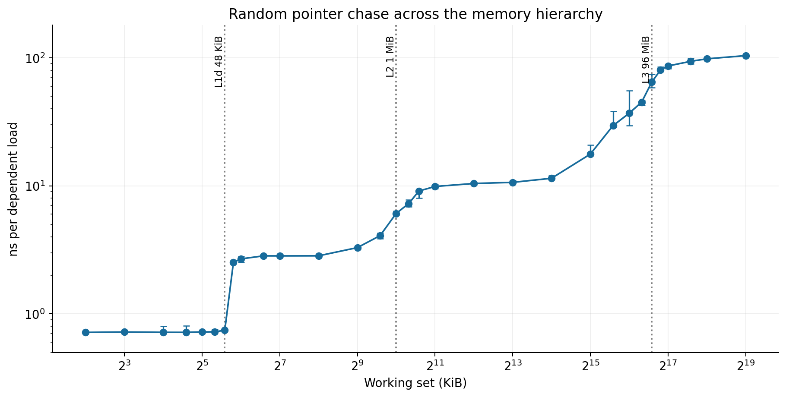
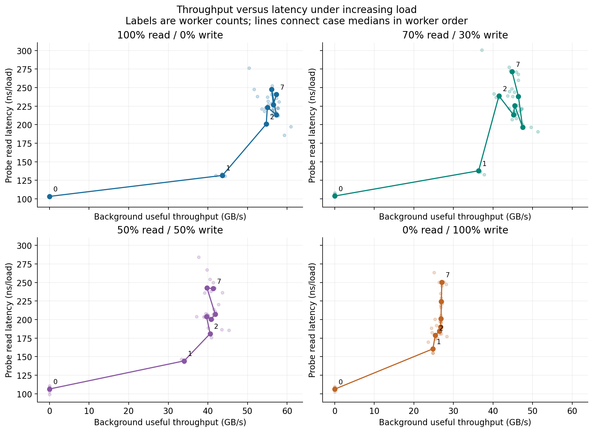
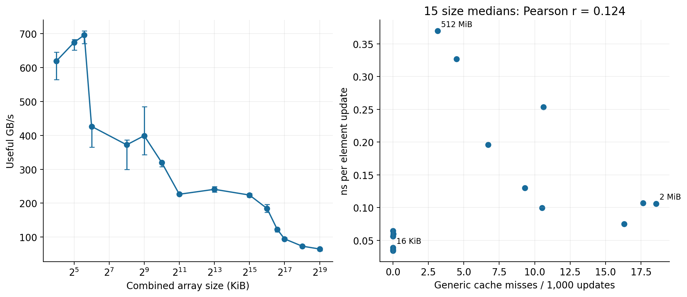

# Cache and Memory Performance Profiling

Andrew Zheng | Advanced Computer Systems | Project 2 | October 17, 2026

## Purpose

The goal of this project was to measure how memory performance changes with data size and access pattern. The tests compare cache-sized data with larger arrays, sequential and random accesses, different read/write mixes, and normal and huge pages. Another test adds background memory traffic to see how it affects latency.

The main results were that small working sets had much lower latency, sequential reads had higher bandwidth than random reads, and adding more workers eventually increased latency without adding much bandwidth. The tests also showed why initialization should be timed separately from the main computation.

## System and test setup

| Item | Configuration |
| --- | --- |
| CPU | AMD Ryzen 7 9850X3D, 8 cores and 16 logical CPUs |
| Cache | 48 KiB L1 data cache per core, 1 MiB L2 per core, 96 MiB shared L3 |
| Operating system | Ubuntu 24.04.5 LTS under WSL2 |
| Kernel | `6.18.33.2-microsoft-standard-WSL2` |
| Compiler | GCC 13.3.0 |
| Memory | 32 GB installed; about 15 GiB available to the WSL guest as total RAM |
| Swap | 4 GiB configured in WSL |
| SMT and NUMA | SMT enabled; one NUMA node visible in WSL |
| Page sizes | 4 KiB normal pages and 2 MiB huge pages; THP set to `madvise` |
| Frequency settings | Linux frequency controls unavailable; actual CPU frequency not recorded |

CPU and memory BIOS settings stayed unchanged during the experiments, but their exact values and the effective memory speed were not recorded. Later single-thread tests were pinned to CPU 0. Background workers used CPUs 2, 4, 6, 8, 10, 12, and 14 so they did not share the same reported core as the probe or each other. WSL still depends on Windows scheduling, so pinning does not completely isolate the tests.

Most settings were tested five times. The tables use medians, and the timing plots show the minimum and maximum where marked. These ranges show variation between trials, not confidence intervals. Slow results were kept rather than removed. The page-counter tests used two separate runs with five trials each.

The latency tests follow a pointer chain, where each load gives the address for the next load. Most use eight million loads per trial. Setup and warmup are outside timing unless stated otherwise. Bandwidth is calculated from useful bytes processed divided by elapsed time. It does not include all of the extra traffic caused by the memory system. GB/s uses decimal gigabytes; KiB and MiB describe allocation sizes.

## Latency and working-set size



*Figure 1. Random pointer-chain latency. Points show medians, with minimum–maximum ranges. Vertical lines mark the reported cache sizes.*

| Representative memory region | Working set | Median ns/load | Min–max ns/load |
| --- | ---: | ---: | ---: |
| L1 | 16 KiB | 0.717 | 0.715–0.799 |
| L2 | 512 KiB | 3.290 | 3.212–3.299 |
| L3 | 8 MiB | 10.636 | 10.541–11.020 |
| Main memory | 512 MiB | 103.839 | 102.351–104.856 |

Latency increased as the working set became too large for the smaller caches. One clear change was from 0.744 ns at 48 KiB to 2.522 ns at 56 KiB, near the L1 capacity. The larger sizes also became slower, but the transitions were less sharp.

These values represent the whole pointer-chain test, including loop and address-translation costs. They are not exact hardware specifications for each cache. The unloaded test is a baseline without added benchmark workers; other host activity may still be present. Results are reported in nanoseconds because a stable operating frequency was not measured for conversion to cycles.

## Sequential and random access

The next test used a 4 GiB allocation and changed the spacing between pointer nodes. It compared following them in sequential order with following a shuffled chain.

| Node spacing | Sequential ns/load | Random ns/load |
| --- | ---: | ---: |
| 64 B | 1.379 | 125.774 |
| 256 B | 3.682 | 117.636 |
| 1024 B | 4.066 | 117.897 |

Sequential access was much faster. Nearby, predictable accesses allow better use of cache lines and can benefit from prefetching. Random access makes the next address harder to prepare in advance. The small sequential times therefore do not mean that a single DRAM access takes only a few nanoseconds.

Increasing spacing also reduced the number of cache lines visited across the allocation. The full-chain footprints were 4 GiB, 1 GiB, and 256 MiB, all larger than L3. This means the test changes both spacing and the amount of data touched. One random 256-byte trial reached 189.946 ns; it remains in the recorded results.

## Read and write bandwidth

The bandwidth test also used a 4 GiB allocation. Each selected block contained 64 bytes. The read/write mixtures were 100% reads, 70% reads and 30% writes, an equal mix, and 100% writes.

| Pattern | Stride | 100% read | 70/30 | 50/50 | 100% write |
| --- | ---: | ---: | ---: | ---: | ---: |
| Sequential | 64 B | 53.35 | 38.04 | 39.43 | 25.50 |
| Sequential | 256 B | 14.62 | 31.57 | 21.77 | 20.14 |
| Sequential | 1024 B | 13.52 | 16.87 | 14.91 | 13.53 |
| Random | 64 B | 3.93 | 5.11 | 5.73 | 7.79 |
| Random | 256 B | 3.94 | 5.12 | 5.60 | 8.65 |
| Random | 1024 B | 3.90 | 4.74 | 5.45 | 7.19 |

*All values are median useful bandwidth in GB/s.*

Sequential reads at 64-byte stride reached 53.35 GB/s, compared with 3.93 GB/s for random reads. Larger strides lowered sequential read bandwidth because the accessed blocks were farther apart. Random read bandwidth stayed around 3.9 GB/s.

Random writes had higher throughput than random reads in this test. This does not mean individual writes had lower latency: stores can be buffered and overlap with other work. Useful bandwidth also excludes extra traffic such as write allocation and the index array used for random access.

One sequential 256-byte read trial fell to 3.40 GB/s. A separate repeat had a median of 14.51 GB/s, close to the original median of 14.62 GB/s. Both sets were kept, and the cause of the slow trial was not determined.

## Memory traffic and loaded latency

A random read probe ran while zero to seven background workers generated memory traffic. Each thread used a private 512 MiB allocation. Measurements used a shared two-second window after a short warmup period. All four read/write mixes were tested.



*Figure 2. Background throughput compared with probe latency. Small dots are individual trials. Numbered points show selected worker counts; the line follows increasing worker count. Each coordinate of a numbered point is a median.*

| Background mix | Highest median GB/s | Workers at that value | No-worker latency ns | Seven-worker latency ns |
| --- | ---: | ---: | ---: | ---: |
| 100% read | 57.28 | 4 | 103.27 | 240.72 |
| 70/30 | 47.47 | 5 | 103.79 | 271.47 |
| 50/50 | 41.85 | 5 | 106.33 | 241.77 |
| 100% write | 27.07 | 7 | 106.06 | 250.33 |

For reads, bandwidth reached 54.74 GB/s at two workers and stayed around 55–57 GB/s afterward. Increasing from two to seven workers added only about 4.6% bandwidth, while probe latency increased from 200.78 to 240.72 ns. This places the approximate knee, where extra workers stop helping much, near two workers.

The 50/50 case also mostly leveled off near two workers. Write-only traffic was already close to its maximum with one worker. The 70/30 results varied more, so there was no single clear knee. In general, adding workers after bandwidth leveled off increased the delay seen by the probe. Even for write-only background traffic, the measured latency is from the read probe, not from individual writes.

## Page size and TLB results

The TLB stores recent virtual-to-physical address translations. Larger pages can let each translation cover more memory. The test compared normal and huge pages while recording `dTLB-load-misses`.

| Working set | Normal-page ns/load | Huge-page ns/load | Normal-page misses per 1,000 loads | Huge-page misses per 1,000 loads |
| --- | ---: | ---: | ---: | ---: |
| 32 MiB | 20.90 | 15.88 | 511.44 | 61.86 |
| 64 MiB | 41.63 | 25.91 | 756.55 | 159.98 |
| 512 MiB | 105.20 | 92.96 | 970.82 | 915.26 |

Huge pages lowered both latency and reported TLB misses. The largest latency improvement was at 64 MiB, about 38%. At 512 MiB the benefit was smaller, about 12%.

The recorded `AnonHugePages` values confirmed huge-page backing inside WSL for the huge-page tests. An earlier 32 MiB huge-page run was unexpectedly slow, so fresh-process repeats were kept alongside the original data. The table uses the later counter tests, which reversed page-mode order on the second run. The event counts are reported per 1,000 pointer loads; they are not exact miss probabilities or proof of the host's page layout.

## AXPY and cache counters

The AXPY test performs `y[i] = 0.5*x[i] + y[i]` on two arrays of doubles. Working-set size counts both arrays. Initialization and warmup are excluded from the steady-state test, and the results are checked afterward. This kernel was compiled with `-O3 -march=native`, allowing vectorization.



*Figure 3. AXPY bandwidth versus size, and the relationship between cache-miss counts and time per update. The comparison uses the median at each size.*

| Combined array size | Useful GB/s | ns/update |
| --- | ---: | ---: |
| 48 KiB | 695.93 | 0.0345 |
| 1 MiB | 319.75 | 0.0751 |
| 2 MiB | 226.38 | 0.1060 |
| 96 MiB | 122.40 | 0.1961 |
| 512 MiB | 64.91 | 0.3697 |

Larger arrays took longer per update. Small arrays could reuse cached data, which explains why their useful bandwidth was much higher than the large-array result. Those high values are not DRAM bandwidth.

The generic cache-miss counts did not follow runtime as expected. For example, the count fell from 18.57 misses per 1,000 updates at 2 MiB to 3.15 at 512 MiB, even though the larger case was slower. Across the 15 tested sizes, the correlation was only 0.124, showing a weak relationship. These counters could not explain the timing trend by themselves. Their exact meaning on this processor under WSL was not verified, so they should not be treated as separate L1, L2, or L3 miss rates.

## Timing pitfall: including initialization

The final comparison timed one AXPY pass over 512 MiB, either with arrays already prepared or with initialization inside the timed region.

| Timed work | Median time | Median minor page faults |
| --- | ---: | ---: |
| Kernel only | 12.87 ms | 0 |
| Initialization and kernel | 160.60 ms | 131,072 |

Including initialization made the result about 12.5 times slower. First writes caused page faults, and filling the arrays also took time. The difference cannot all be assigned to page faults because initialization changes the work and cache state too.

This shows why the timing boundary matters. To measure steady-state kernel speed, allocation, initialization, and warmup should be handled before timing. Startup cost can still be measured separately.

## Connection to memory models

Average Memory Access Time (AMAT) is often written as:

`AMAT = hit time + miss rate × miss penalty`

The idea is that even occasional slow accesses can raise average access time. As a simple example, using the measured representative times for L1, L2, L3, and memory, assume 90%, 8%, 1.5%, and 0.5% of accesses are served by those regions:

`0.90(0.717) + 0.08(3.290) + 0.015(10.636) + 0.005(103.839) = 1.587 ns`

Changing the assumed percentages to 90%, 7%, 1%, and 2% raises the average to 3.059 ns. These percentages are examples, not measured hit rates. The measured times include whole-test overhead, so this illustrates the effect of slow accesses rather than predicting AXPY performance.

Little's Law states:

`average requests in progress = requests per second × average time per request`

A dependent chain taking 103.839 ns per load completes about 9.63 million loads per second. Multiplying those values gives about one request in progress, consistent with waiting for each load before starting the next.

For the loaded test, dividing 54.735 GB/s by an assumed 64 bytes per request and multiplying by 200.778 ns gives about 172 requests. This is only a rough illustration. The bandwidth belongs to streaming workers, while the latency belongs to a separate random probe, so the calculation does not measure actual queue depth. The direct result is that throughput leveled off while the probe's delay increased.

## Limitations and conclusion

WSL and Windows scheduling could affect the results. CPU frequency and background host activity were not continuously recorded. Pinning reduced guest CPU migration but did not reserve the physical cores. The early latency CSV also did not record affinity, so its pinning cannot be confirmed from the data alone.

The counter tests recorded full enabled/running time, but that does not verify the exact hardware meaning of each event. The later metadata recorded no swap activity during the runs. Several cases still had large timing ranges, and the report uses medians without claiming statistical confidence.

Overall, the tests showed that memory performance depends on more than data size. Access order, spacing, read/write mix, and competing traffic all mattered. Huge pages helped most at intermediate working-set sizes. The AXPY comparison also showed that including setup can change a reported result by more than an order of magnitude.

## Files and reproduction

The [source code](src/) and [runner scripts](scripts/) contain the benchmarks. Original runs are in [results](results/). Copies of the report inputs are in [report/data](report/data/), and numerical summaries are in [report/processed](report/processed/). The other plots are retained in [report/figures](report/figures/) as supporting results.

Full build and run commands are in [Reproducing the experiments](report/REPRODUCING.md). To regenerate all eight supporting plots from the existing data, run the following from the repository root:

```bash
python3 -m venv .venv-report
source .venv-report/bin/activate
python3 -m pip install -r project2-memory/report/requirements.txt
python3 project2-memory/report/make_figures.py
```

## References

1. Linux man-pages, [perf_event_open](https://man7.org/linux/man-pages/man2/perf_event_open.2.html).
2. Linux kernel documentation, [Transparent Hugepage Support](https://docs.kernel.org/admin-guide/mm/transhuge.html).
3. John D. C. Little, [A Proof for the Queuing Formula L = λW](https://doi.org/10.1287/opre.9.3.383), 1961.
