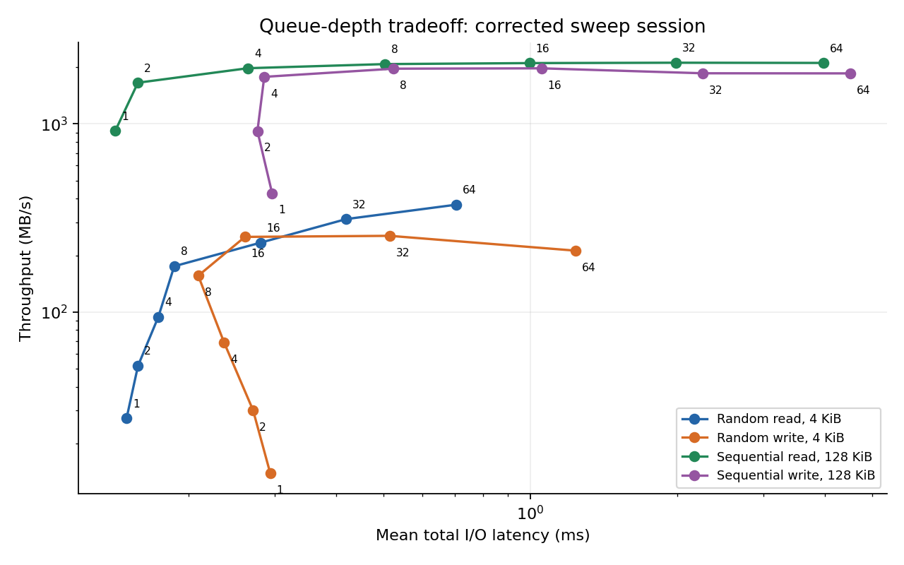
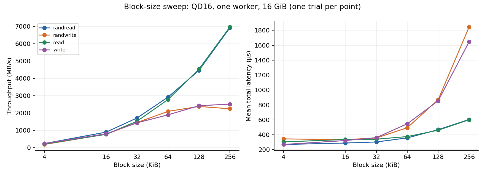
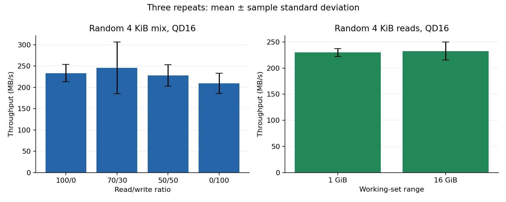
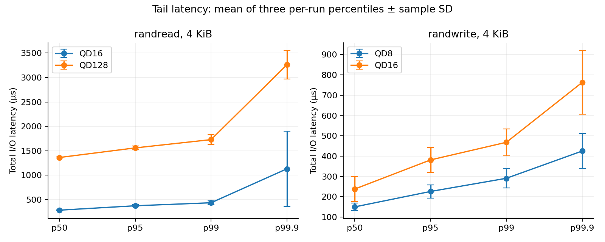
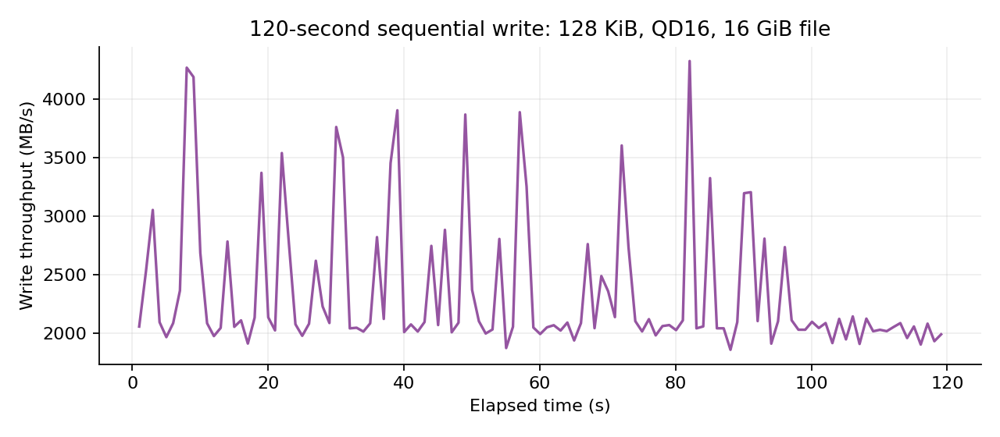

# Project 3: SSD Performance Profiling

Andrew Zheng — Advanced Computer Systems

## Purpose

This project uses FIO to measure SSD performance with different block sizes, access patterns, read/write mixes, and queue depths. The main question is how much extra throughput comes from keeping more requests in progress, and how that affects latency.

The tests ran through WSL2. They measure the whole storage path seen by Ubuntu, including its virtual disk and the Windows host. They do not measure the SSD hardware by itself.

## System and test setup

| Item | Setup |
|---|---|
| SSD | Samsung SSD 9100 PRO 2TB, NVMe, identified using Windows PowerShell |
| CPU | AMD Ryzen 7 9850X3D, 8 cores / 16 logical CPUs |
| Host | Windows 11; about 802 GiB free on C: before testing |
| Guest | Ubuntu 24.04.5 LTS, WSL2 |
| Kernel | 6.18.33.2-microsoft-standard-WSL2 |
| Guest memory | Approximately 15 GiB reported by `free -h` |
| FIO | 3.36 |
| Filesystem | ext4 on WSL virtual disk `/dev/sdd` |
| Test target | Dedicated regular file `test-data/ssd-test.bin`, 16 GiB |
| I/O settings | `libaio`, `direct=1`, one worker |
| Normal test duration | 5-second warm-up, followed by 30 seconds of measurement |
| Data | Refreshed pseudo-random buffers; compression percentage set to zero |
| Alignment | Default block-aligned offsets; all tested block sizes are multiples of 4 KiB |

The 16 GiB file is about 0.86% of the physical SSD's advertised byte capacity. It was filled once before the read tests. This prevents testing an unwritten file, but is not full-drive preconditioning. The working-set comparison also used the first 1 GiB of the same file, starting at offset zero.

Only this disposable file was used for writes. No raw device or partition was benchmarked. Windows free space was checked because the free space shown inside WSL is not necessarily the free space on the physical drive.

Direct I/O bypasses the Linux file-data cache. It does not prove that every request bypasses all host or device caching. Timed writes did not request an fsync after each operation, so their latency is not a measurement of durable writes after a power failure. Temperature, SMART counters, negotiated PCIe link speed, and host background I/O were not recorded.

Throughput is reported in decimal MB/s. Block sizes use KiB. Latencies use FIO's total `lat_ns` values, converted to microseconds, including submission and completion latency.

## QD1 baselines

QD1 means that only one request is outstanding. The original four baseline runs all reported depth 1 and no FIO errors.

| Workload | IOPS | MB/s | Mean latency (µs) | p95 (µs) | p99 (µs) |
|---|---:|---:|---:|---:|---:|
| Random read, 4 KiB | 8,683 | 35.6 | 113.6 | 154.6 | 191.5 |
| Random write, 4 KiB | 7,300 | 29.9 | 134.8 | 158.7 | 207.9 |
| Sequential read, 128 KiB | 8,006 | 1,049.3 | 123.7 | 173.1 | 224.3 |
| Sequential write, 128 KiB | 5,233 | 685.9 | 180.7 | 209.9 | 264.2 |

Larger requests transferred more bytes with each operation. Sequential reads therefore had much higher bandwidth even though their IOPS were similar to random reads. These baselines change both block size and access pattern, so they cannot separate the two effects.

The final check session repeated these workloads three times:

| Workload | Mean MB/s ± sample SD | Mean latency (µs) | Mean per-run p95 (µs) | Mean per-run p99 (µs) |
|---|---:|---:|---:|---:|
| Random read, 4 KiB | 32.8 ± 7.5 | 127.7 | 170.3 | 225.3 |
| Random write, 4 KiB | 29.8 ± 0.6 | 135.1 | 160.8 | 226.3 |
| Sequential read, 128 KiB | 972.5 ± 76.2 | 134.0 | 196.3 | 281.6 |
| Sequential write, 128 KiB | 694.5 ± 10.6 | 178.7 | 203.1 | 272.0 |

## Queue depth and latency



The point labels are requested queue depths. This figure uses only the corrected sweep session, with one run per point. Both axes use logarithmic scales. Later sessions are discussed separately because their throughput changed substantially.

In this session, sequential reads mostly leveled off around QD8. Moving from QD8 to QD64 increased throughput from 2,079 to 2,109 MB/s, while average latency rose from 503 to 3,977 µs. Extra queued requests added waiting time with little extra throughput.

Sequential writes had a similar bend around QD8–16. Random writes leveled off around QD16–32 at about 61,000–62,000 IOPS, then slowed at QD64. These are approximate knees for this session, not fixed properties of the SSD.

Random reads were still improving at QD64, so two additional tests were run in the next session:

| Random 4 KiB reads | IOPS | Mean latency (ms) |
|---|---:|---:|
| QD128 | 96,302 | 1.329 |
| QD256 | 97,252 | 2.632 |

Doubling depth from 128 to 256 added only about 1% more IOPS and nearly doubled latency. This suggests QD128 was near the useful limit for that workload in that session. The later three QD128 repeats averaged 93,348 IOPS.

The highest observed small-block random-read rate was 97,252 IOPS. The highest observed 4 KiB random-write rate was 75,169 IOPS in a QD16 repeat. These are observed rates under the tested settings, not manufacturer limits.

### Variation between sessions

Sequential 128 KiB reads at QD16 changed from 2,105 MB/s in the corrected sweep to 4,538 MB/s in the block-size sweep. The final three repeats averaged 4,430 ± 520 MB/s. In that final session, QD8 averaged 3,434 MB/s, so increasing to QD16 still helped.

This means the first session's sequential-read plateau should not be treated as a permanent limit. WSL/host activity and device state are possible contributors, but the measurements do not identify the cause. The results are kept by session rather than combined into one smooth curve.

### Little's Law

Little's Law relates the average requests in progress to throughput and latency:

`L = IOPS × average latency in seconds`

For the corrected random-read QD16 run:

`56,988.5 × 0.000280215 ≈ 15.97 requests`

That is close to the requested depth of 16. The analysis script computes this for every run. In the final QD128 repeats, the average of the per-run estimates was 127.95.

This describes the request population measured by FIO. It is not a direct measurement of the SSD's internal hardware queue. Once throughput stops growing, keeping more requests outstanding generally means longer waiting time.

## Block size and access pattern



These tests held queue depth at 16 and used one worker over 16 GiB. Each point has one trial, so no repeat error bars are shown.

Sequential-read throughput increased from 214.5 MB/s at 4 KiB to 6,967.9 MB/s at 256 KiB. Its IOPS fell from 52,364 to 26,580, but each operation moved more data. The 256 KiB sequential-read result was the highest bandwidth observed in the project.

Sequential-write throughput increased from 241.7 to 2,518.0 MB/s over the same block sizes. Larger blocks also increased average latency because each request moved more data.

Random and sequential reads were close at the larger block sizes: at 256 KiB they reached 6,921.9 and 6,967.9 MB/s. Random access was not always slower in these trials. An SSD does not have a mechanical seek delay, and the virtual storage path and run-to-run variation also affect these results.

The observed limits can come from the SSD controller and flash, the PCIe path, the operating systems, or the benchmark worker. The negotiated PCIe link and device telemetry were not captured, so this experiment cannot identify which component set each plateau.

## Read/write mix and working-set size



Bars show means of three runs. Error bars show sample standard deviation, not confidence intervals. Test order was shuffled with a fixed seed for each repeat round.

| Random 4 KiB mix, QD16 | Mean IOPS | Mean MB/s ± SD |
|---|---:|---:|
| 100% read | 57,022 | 233.6 ± 20.7 |
| 70% read / 30% write | 60,028 | 245.9 ± 60.5 |
| 50% read / 50% write | 55,677 | 228.1 ± 25.2 |
| 100% write | 51,126 | 209.4 ± 23.9 |

The first mix sweep slowed as the write percentage increased, but the repeats did not show a consistent ordering. The 70/30 mix had the highest mean and the largest variation. These results do not establish that 70/30 is faster than pure reads.

For random 4 KiB reads at QD16, the 1 GiB range averaged 229.6 ± 7.4 MB/s and the 16 GiB range averaged 232.6 ± 17.1 MB/s. The difference was small compared with the variation. There was no clear working-set benefit in this comparison. Both ranges cover only a small part of the SSD; this does not establish full-drive behavior.

## Tail latency



The median, p50, describes a typical request. p99.9 describes a point below which approximately 99.9% of requests completed. Higher percentiles help show delays that an average can hide.

The following values are means of three per-run percentiles. They are not percentiles of one combined distribution.

| Workload | QD | p50 (µs) | p95 (µs) | p99 (µs) | p99.9 (µs) |
|---|---:|---:|---:|---:|---:|
| Random read, 4 KiB | 16 | 284.7 | 374.8 | 436.2 | 1,130.5 |
| Random read, 4 KiB | 128 | 1,362.6 | 1,559.2 | 1,728.5 | 3,260.4 |
| Random write, 4 KiB | 8 | 150.4 | 226.3 | 291.2 | 425.3 |
| Random write, 4 KiB | 16 | 238.3 | 381.6 | 468.3 | 763.2 |
| Sequential read, 128 KiB | 8 | 300.7 | 444.4 | 535.9 | 1,552.4 |
| Sequential read, 128 KiB | 16 | 479.2 | 613.0 | 711.3 | 1,460.9 |
| Sequential write, 128 KiB | 8 | 261.5 | 1,170.1 | 1,400.8 | 2,506.8 |
| Sequential write, 128 KiB | 16 | 494.9 | 1,493.7 | 1,750.4 | 4,014.1 |

QD16 and QD128 compare a middle depth and a near-plateau depth for random reads. Random-write QD8/16 compares a middle depth with the earlier session's approximate knee. The full sweep also preserves tail percentiles through QD64 for the other workloads.

Higher depth generally increased the latency tail, especially for random reads and sequential writes. Not every percentile rose: sequential-read p99.9 was slightly lower at QD16 in the repeats. Occasional delays and variation matter, so a strict increase should not be assumed.

## Sustained writing and device state



The final test wrote sequentially for 120 seconds with 128 KiB requests at QD16. It reused the 16 GiB file and recorded bandwidth roughly once per second, with no excluded warm-up.

The first ten logged samples averaged 2,729 MB/s; the last ten averaged 2,013 MB/s, a decrease of about 26%. The complete FIO result averaged 2,356 MB/s. There are 119 log samples, so the log does not include a separate final sample for every fraction of the run.

This shows a slowdown over the measured interval. SLC cache behavior, garbage collection, temperature, and host activity are possible explanations. Without telemetry or controlled preconditioning, the test does not prove any one of them, and it does not establish long-term steady state. The file had already been used by earlier experiments, so this was not a fresh-drive test.

## A misleading setup found during testing

The first queue-depth script named files `qd1`, `qd2`, and so on, but its base configuration kept `iodepth=1`. Every output reported depth 1. Looking only at the filenames would have suggested that increasing queue depth did not help.

The corrected script saved a separate configuration for each test and checked the recorded depth afterward. The 28 misconfigured results are preserved in `results/queue_20261022T084354Z` and marked `valid_sweep=False` in the CSV. They are excluded from the performance plots and maximum-rate calculations.

For depths above 64, FIO's distribution groups requests into `>=64`. That histogram alone cannot distinguish 128 from 256. The saved settings and Little's Law estimate provide additional checks.

## Files and reproduction

- `results/baseline/`: four original QD1 results.
- `results/queue_fixed_20261022T185707Z/`: corrected QD1–64 sweep and exact configurations.
- `results/more_20261022T210733Z/`: block sizes, mixes, and random-read QD128/256.
- `results/checks_20261022T213625Z/`: repeated trials, system information, test order, and sustained-write log.
- `results/analysis/`: parsed per-run data, repeat summaries, bandwidth trace, and validation counts.
- `scripts/`: benchmark runners and analysis code.
- `plots/`: five report figures.

There are 114 valid benchmark runs plus 28 preserved misconfigured runs. All 142 returned zero FIO errors and zero short/dropped I/Os. This is not a data-integrity verification test.

To regenerate the tables and figures from the included data, run from this project folder:

```bash
python3 -m venv .venv
source .venv/bin/activate
python -m pip install -r requirements.txt
python scripts/analyze.py
```

The analysis does not run any SSD benchmarks. It keeps read and write percentiles separate for mixed workloads, because averaging their percentiles would not produce a valid overall percentile. Mixed total mean latency is weighted by I/O count.

For new measurements, use the existing prepared test file and run:

```bash
bash scripts/run_queue_fixed.sh
python3 scripts/run_more.py
python3 scripts/run_checks.py
```

These commands perform writes. The runners regenerate configurations with the current project location. Do not use `scripts/run_queue.sh`; it is retained only as evidence of the configuration mistake. The original saved `.fio` files contain the original absolute target path.

On a new setup, inspect the target filesystem and host free space before using `scripts/prepare_test_file.sh`. It creates a new 16 GiB disposable file and refuses to overwrite an existing file. Do not rerun preparation just to regenerate plots.

## Conclusion

Queue depth improved throughput by allowing more requests to be in progress at once. Near a plateau, extra depth mainly increased latency. Larger blocks moved more data per second, while small requests were more limited by the number of operations completed.

The tests also showed why repeated runs and checking the actual settings are necessary. Performance varied between sessions, and one incorrect configuration initially prevented the queue depth from changing. The results describe this WSL2 setup and the tested file ranges, rather than a fixed maximum for the SSD.

## AI assistance

ChatGPT helped draft the FIO configurations and scripts, interpret the output, generate plots, and draft this report. The measurements came from FIO runs on my computer. An error in the first AI-assisted queue-depth script was found by inspecting the output, corrected, and rerun. The report records that mistake and the limits of the measurements.

## Tool documentation

- [FIO documentation](https://fio.readthedocs.io/en/latest/fio_doc.html)
- [Microsoft: WSL disk space](https://learn.microsoft.com/en-us/windows/wsl/disk-space)
